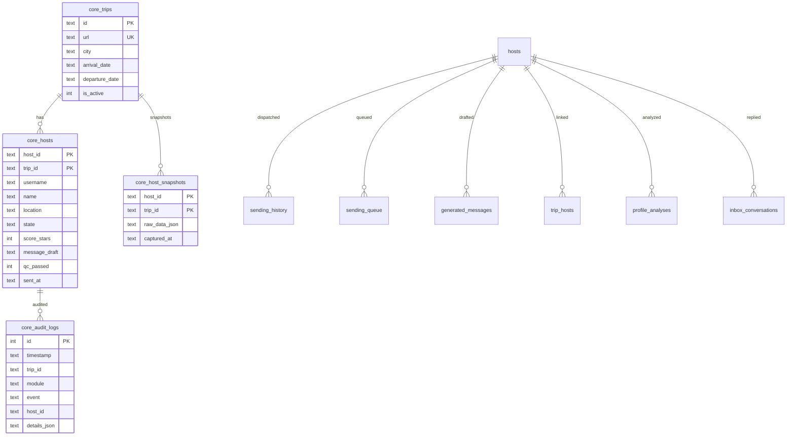
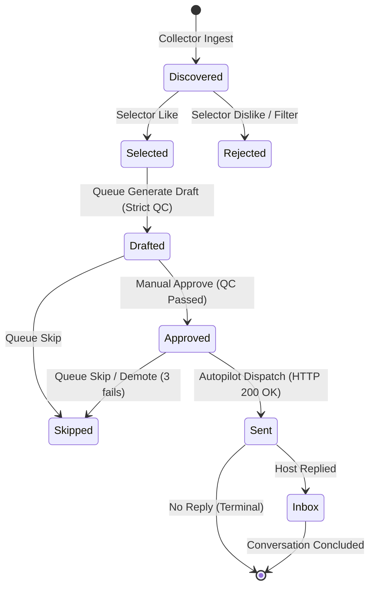

# Архитектурная спецификация (DDD) Couchsurfing Outreach Platform

## 1. Обзор архитектуры

Платформа консолидирована в единую каноническую доменно-ориентированную архитектуру (Domain-Driven Design).
Устранено разделение на две параллельные системы:
- **Канонический доменный слой:** `core/`
  - `core/database.py`: Единый слой персистентности, менеджер соединений SQLite (WAL, Foreign Keys=1, busy_timeout=15s), единая точка входа для всех операций с БД.
  - `core/models.py`: Единые доменные модели Pydantic (Trip, HostCard, HostState, SendingAttempt, MessageDraft, AuditEvent и др.).
  - `core/context.py`: Единый контекст гостя, факты и анти-галлюцинационные фильтры (`PersonalContextManager`, `ContextAssembler`, `validate_text_purity`).
  - `core/collector.py`: Единый коллектор и анализатор анкет (`CollectorEngine`, `ProfileAnalyzer`).
  - `core/selector.py`: Движок отбора хостов для поездки (`SelectorEngine`).
  - `core/queue.py`: Движок очереди отправки, генератор персонализированных запросов и Strict QC (`QueueEngine`, `RequestQueueManager`).
  - `core/autopilot.py`: Движок автономной отправки, контроль интервалов (human jitter), суточных лимитов и фиксация отправок (`AutopilotEngine`).
  - `core/inbox.py`: Движок обработки входящих ответов и генерации рекомендаций (`InboxEngine`).
- **Тонкие фасады обратной совместимости (Root Facades):**
  - `database.py` -> реэкспорт из `core/database.py`
  - `personal_context.py` -> реэкспорт из `core/context.py`
  - `context_assembler.py` -> реэкспорт из `core/context.py`
  - `profile_analyzer.py` -> реэкспорт из `core/collector.py`
  - `request_manager.py` -> реэкспорт из `core/queue.py`

---

## 2. Модель базы данных и персистентности

### 2.1. Единый источник истины (Single Database)
- Основная база данных: `output/couchsurfing_platform.db` (конфигурируется через переменную окружения `CS_DB_PATH`).
- Режим журналирования: `PRAGMA journal_mode = wal;`
- Контроль внешних ключей: `PRAGMA foreign_keys = 1;`
- Таймаут ожидания блокировок: `PRAGMA busy_timeout = 15000;`
- **Строгая политика единственного соединения:** вызов `sqlite3.connect` изолирован в функции `core.database.get_connection()`. Прямые обращения из бизнес-модулей запрещены и контролируются AST-тестом `tests/test_architectural_invariants.py`.

### 2.2. Канонические таблицы

---

## 3. Машина состояний кандидата (State Machine)

### Архитектурные инварианты состояний:
1. **Необратимость статуса 'sent':** Отправленное сообщение фиксируется в `sending_history` и не может быть отменено или переведено обратно в `drafted`/`approved`/`skipped`.
2. **Strict QC перед утверждением:** Письмо не может быть утверждено (`approve`), если нарушены лимиты длины (50–105 слов) или найдены запрещенные слова.
3. **Изоляция поездок (Trip Scoping):** Хосты поездки A недоступны для отправки автопилотом в поездке B.
4. **Сохранение исходных данных:** Снятие хоста из очереди (`skip` / `clear_queue`) переводит статус в `skipped` и никогда не удаляет карточку хоста или её неизменяемый снимок (`core_host_snapshots`).

---

## 4. Скрипты инспекции и миграции (`scripts/`)

- `scripts/inspect_databases.py`: Диагностика базы данных, подсчет строк, проверка целостности PRAGMA, поиск дубликатов, сирот и расхождений с JSON.
- `scripts/migrate_legacy_database.py`: Полная автоматическая консолидация данных в каноническую структуру с созданием атомарного бэкапа перед запуском. Поддерживает режимы `--dry-run` и боевого применения.
- `scripts/verify_migration.py`: Автоматическая верификация нулевых потерь данных и проверка соблюдения инвариантов бизнес-логики.

---

## 5. Автоматизированное тестирование (`tests/`)

- `tests/test_tz_pipeline.py`: Интеграционные тесты 10 ключевых требований ТЗ (трипы, коллектор, селектор, QC, автопилот, инбокс, аудит, неизменяемость данных).
- `tests/test_architectural_invariants.py`: Проверка AST на отсутствие сторонних соединений с SQLite, проверка WAL/Foreign Keys, необратимости статуса `sent`, изоляции поездок.
- `tests/test_migration_and_lifecycle.py`: Проверка идемпотентности миграции и полного сквозного цикла кандидатов.
