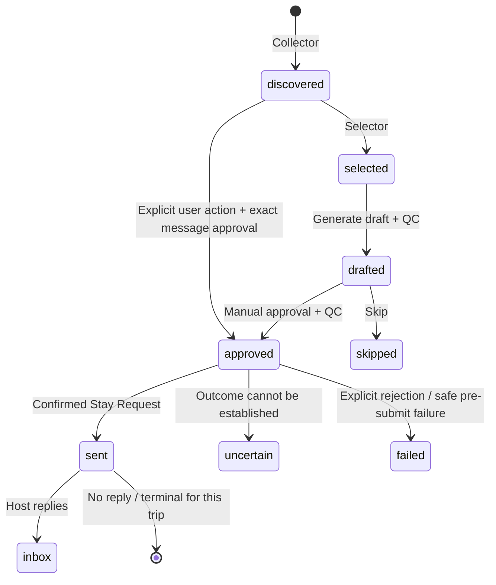

# Архитектура Couchsurfing Outreach Platform

## 1. Текущее состояние

Приложение — модульный монолит на FastAPI и SQLite, который постепенно выделяет DDD-границы. `core/` содержит доменную логику, прикладные сценарии и доступ к данным; `app.py` остаётся HTTP-адаптером, но часть маршрутов всё ещё содержит SQL и координацию сценариев напрямую. `ApproveFoundHosts` уже выделен как use case с trip-scoped репозиторием. Перенос остальных сценариев не завершён.

Каноническое состояние очереди по поездкам хранится в `core_hosts`. Генерация и проверка исходящих текстов сосредоточены в `core.messaging`. История и попытки отправки моделируются отдельно от карточек профилей. Старые таблицы и корневые модули остаются в схеме или runtime там, где ещё есть переходные потребители.

`requests_queue.json` не является постоянным источником очереди: `/api/requests/export` формирует выгрузку по запросу. Отдельный фильтр `filter_hosts.py` пока остаётся переходным сценарием на JSON-файлах и вызывается из UI через `/api/start_filter`.

## 2. Границы модулей

### Канонические модули

| Модуль | Ответственность |
|---|---|
| `core/models.py` | Общие типы поездки, карточки хоста и состояний. |
| `core/database.py` | SQLite-схема, соединения, транзакции и миграции. |
| `core/collector.py`, `core/selector.py` | Сбор профилей, анализ и отбор в контексте поездки. |
| `core/host_activity.py`, `core/host_policy.py`, `core/identity.py` | Активность, исключающие правила и разрешение идентичности. |
| `core/context.py`, `core/messaging.py` | Контекст гостя, построение и QC исходящего сообщения. |
| `core/application/approve_found_hosts.py` | Сценарий массового утверждения найденных хостов. |
| `core/repositories/host_queue_repository.py` | Trip-scoped чтение и запись карточек очереди. |
| `core/queue.py` | Операции очереди; часть сценарной логики и SQL ещё остаётся здесь. |
| `core/dispatch_identity.py` | Разрешение идентичности, резервирование, блокировки и восстановление диспетчеризации. |
| `core/dispatch_confirmation.py` | Проверка доказательств отправки и выпуск capability для подтверждённого перехода. |
| `core/autopilot.py` | Лимиты, подтверждённый переход в `sent` и фиксация результата. |
| `core/inbox.py` | Доменная обработка входящих сообщений. |

### HTTP- и внешние адаптеры

- `app.py` предоставляет FastAPI UI/API, запускает фоновые процессы и делегирует часть сценариев в `core/`.
- `auto_sender.py` управляет Playwright и взаимодействием с Couchsurfing. Он должен отправлять сохранённый утверждённый текст, не генерируя его заново.
- `scraper.py` запускает сбор профилей и передаёт результаты в канонический слой.
- `process_manager.py` координирует внешние процессы, запускаемые приложением.

### Переходные компоненты

Корневые фасады `database.py`, `request_manager.py`, `personal_context.py`, `context_assembler.py` и `profile_analyzer.py` переэкспортируют API из `core/`. Они ещё используются активными модулями и удаляются только после миграции потребителей.

`filter_hosts.py` вместе с `/api/start_filter` остаётся отдельным JSON-сценарием. Он не является канонической очередью и требует отдельного переноса на поездочную модель, прежде чем его можно будет убрать.

## 3. Хранение и источники истины

SQLite открывается через `core.database.get_connection()` и использует WAL, включённые внешние ключи и `busy_timeout=15000`. Бизнес-модули не должны создавать собственные соединения.

| Таблица | Область и роль |
|---|---|
| `core_trips` | Поездки и их параметры. |
| `core_hosts` | Карточка хоста в конкретной поездке: состояние очереди, черновик, оценка и `sent_at`. Один хост может иметь отдельную карточку в нескольких поездках. |
| `message_approvals` | Неизменяемая привязка явного пользовательского действия к canonical host key, поездке, точной версии текста и SHA-256. Изменяемы только статус отзыва/устаревания и причина. |
| `core_host_snapshots` | Снимок собранных данных хоста в поездке. |
| `host_identities` | Глобальные идентификаторы и алиасы хоста, используемые для дедупликации. |
| `sending_attempts` | Запись конкретной попытки отправки: поездка, идентификаторы хоста, состояние, признак намерения отправить, доказательства, ошибка и результат. Не ссылается на профиль `hosts` или `core_hosts`. |
| `host_dispatch_locks` | Глобальная блокировка канонической идентичности на время и после диспетчеризации. Защищает от параллельной и повторной отправки. Ссылается на `sending_attempts`, а не на профиль. |
| `sending_history` | Журнал событий отправки и аудиторский read model. Содержит снимки `host_id`/`username`, `trip_id`, `attempt_id`, статус, доказательство и время. Не имеет внешнего ключа на `hosts` или `core_hosts`; профиль не нужен для сохранения события. |
| `core_audit_logs` | Аудит доменных событий, привязанный к поездке и модулю. |

Источники истины разделены по смыслу:

- очередь и состояние хоста в поездке — `core_hosts`;
- данные и итог отдельной попытки — `sending_attempts`;
- глобальная защита от дублей и параллельной отправки — `host_dispatch_locks`;
- хронология событий для аудита и отображения — `sending_history`;
- глобальные алиасы — `host_identities`.
- право на отправку конкретного текста — `message_approvals`; статус `core_hosts.state='approved'` сам по себе не даёт такого права.

`sending_history` — журнал событий, а не таблица профилей. Её `host_id` и `username` являются сохранёнными значениями идентичности на момент события. `attempt_id` и `trip_id` используются для корреляции; они не создают зависимости истории от наличия строки профиля.

### Схемные остатки legacy

Таблицы `hosts`, `trip_hosts`, `generated_messages`, `sending_queue` и совместимое представление `requests` всё ещё создаются схемой. В частности, у старой `sending_queue` остаётся FK на `hosts`, а `requests` строится на этих таблицах. Это legacy-схема, а не целевая модель очереди.

Переезд не завершён полностью: `get_sent_usernames()` читает legacy `sending_queue` и соединяет её с `hosts`; `inbox_checker.py` использует представление `requests`; миграционные и инспекционные скрипты проверяют legacy-таблицы. Поэтому наличие старых таблиц в БД и отдельных чтений документировано как переходное состояние. Удалять `hosts` и связанные таблицы можно после переноса и проверки этих потребителей.

## 4. Жизненный цикл поездочной очереди

`sent` в `core_hosts` относится к конкретной поездке. Оно не заменяет глобальную блокировку отправки: один хост может иметь поездочные карточки, но новый dispatch должен пройти проверку глобальной идентичности и блокировок.

Правила переходов:

1. Кандидаты, черновики и утверждения обрабатываются в контексте `trip_id`.
2. `ApprovalService` фиксирует только явное пользовательское утверждение; запись хранит canonical host key, `trip_id`, `host_id`, message id, SHA-256 точного UTF-8 текста, версию, время и источник действия. Старые `approved` статусы без такой записи не дают права на отправку.
3. Селектор очереди требует `APPROVED_VALID`. Он повторно сверяет статус, поездку, identity, версию, хеш и сохранённый текст. AI, сборщик и генератор сами запись approval не создают.
4. `AutoSender.process_host()` независимо проверяет approval до навигации, перед вводом, после ввода и после reservation непосредственно перед кликом. В Playwright передаётся сохранённый точный текст без runtime-санитизации; значение поля формы сравнивается с утверждённой строкой.
5. Перед кликом сохраняется аудит `DISPATCH_AUTHORIZED` с approval id, attempt id, хешем и версией.
6. Обычный HTTP 2xx, навигация в чат или общий текст успеха сами по себе не подтверждают отправку.
7. Перевести поездочную карточку в `sent` может только `AutopilotEngine.mark_as_sent()` с валидным `ConfirmationCapability` и подходящим HTTP-статусом.
8. Неопределённый исход должен запрещать автоматический повтор до сверки; хост не следует автоматически возвращать в `approved`.
9. `skip` и очистка очереди меняют поездочное состояние и не должны стирать журнал попыток.

## 5. Фактический поток отправки

1. `QueueEngine` / `RequestQueueManager` выбирает утверждённые карточки из `core_hosts` только для поездки и допускает их дальше лишь после успешной проверки `message_approvals`.
2. `auto_sender.py` снова проверяет identity, trip, hash и версию; затем `reserve_host_for_dispatch()` создаёт `sending_attempts` и `host_dispatch_locks`.
3. Перед вводом и перед кликом approval сверяется повторно; текст в поле формы должен совпасть посимвольно с утверждённым текстом. Аудит связывает проверенное approval с `attempt_id`.
4. Playwright открывает форму Stay Request и взаимодействует с сайтом. Approval не доказывает успешную отправку.
5. `dispatch_confirmation.py` проверяет, что наблюдаемое доказательство относится именно к отправке Stay Request. При подтверждении выдаётся capability, которую `mark_as_sent()` валидирует повторно.
6. При подтверждённом исходе `mark_as_sent()` транзакционно обновляет карточку `core_hosts`, добавляет событие `SENT_SUCCESS` в `sending_history`, обновляет состояние и результат `sending_attempts` и помечает capability использованной. `auto_sender.py` после этого пишет локальный лог как вспомогательный артефакт.
7. При отказе или неопределённом исходе отправщик вызывает соответствующие методы автопилота и сохраняет диагностические сведения; неопределённый исход не считается успешным.

Схема Phase 4.2 регистрируется как идемпотентная миграция `006_immutable_message_approvals`: добавляет `message_approvals`, `core_hosts.message_version` и триггер инкремента версии при любом изменении `message_draft`. Старым сообщениям approval автоматически не выдаётся. Production startup проверяет обязательные таблицы read-only способом; миграции выполняются отдельно.

Проверка SQLite и внешний клик Playwright не могут быть одной атомарной транзакцией. Есть короткое TOCTOU-окно между последней проверкой и внешним действием; код минимизирует его повторной проверкой после reservation и сохраняет проверенную связку в аудите, но не обещает атомарность с сайтом.

**Ограничение идентификации пользователя:** существующий FastAPI не имеет аутентификации; Uvicorn слушает `0.0.0.0`. Approval endpoints доступны как UI API, а `created_by='user:…'` — фиксированный маркер кода, не доказательство личности вызывающего. Поэтому приложение проверяет неизменённый текст и факт вызова явного endpoint, но пока не может криптографически отличить нажатие человеком от прямого запроса другого клиента, имеющего сетевой доступ. Для строгой гарантии «только пользователь» нужен слой аутентификации/авторизации перед approval endpoints.

### Важные границы текущей реализации

Попытка и событие `RESERVATION` могут существовать без строки в `hosts`; схема `sending_history` не зависит от legacy-профиля. `mark_as_sent()` требует поездочную строку `core_hosts` и валидный `ConfirmationCapability`. Если карточка отсутствует, метод отказывает и не фиксирует успешный переход. Поэтому попытки независимы от legacy `hosts`, но подтверждённая отправка всё ещё зависит от наличия карточки хоста в `core_hosts`.

В обычном успешном пути `mark_as_sent()` одной SQLite-транзакцией переводит карточку `core_hosts`, создаёт `SENT_SUCCESS` и `REQUEST_SENT_VERIFIED`, обновляет `sending_attempts`, переводит `host_dispatch_locks` в `sent` и помечает capability использованной. Исторические несогласованные записи требуют адресной сверки по attempt ID и доказательствам; массовое исправление без проверки запрещено.

До внешнего клика остаётся незакрытая crash-recovery граница: `reserve_host_for_dispatch()` создаёт попытку и lock в `reserved`, затем отправитель пишет `DISPATCH_AUTHORIZED` и выполняет действие браузера. Сейчас `ApprovalService.record_dispatch_authorization()` фиксирует audit, но не переводит attempt/lock в состояние с зафиксированным `send_intent_committed`. Функция `recover_crashed_dispatches()` при встрече `reserved` с нулевым флагом освобождает блокировку. Поэтому нельзя подключать эту функцию к production startup без предварительной транзакционной фиксации намерения непосредственно перед внешним действием и интеграционной проверки всей цепочки.

## 6. Восстановление и мониторинг dispatch

`recover_crashed_dispatches()` в `core.dispatch_identity` реализует правила восстановления:

| Состояние при запуске восстановления | Результат | Причина |
|---|---|---|
| `reserved`, `send_intent_committed = 0` | `released` | Намерение отправить не фиксировалось; внешний эффект считается не начатым. |
| `reserved`, `send_intent_committed = 1` | `uncertain` | Отправка могла произойти до падения. |
| `sending` | `uncertain` | Внешнее действие могло произойти, результат неизвестен. |
| `sent`, `uncertain`, `already_contacted` | Без изменений | Сохраняется глобальное подавление повторной отправки. |

**Текущее ограничение:** функция восстановления существует, но в production startup не вызывается. Текущий отправитель резервирует попытку и пишет `DISPATCH_AUTHORIZED`, однако рабочий путь ещё не фиксирует `send_intent_committed` непосредственно перед внешним действием. Поэтому recovery-функцию нельзя запускать над активными/неразобранными reservations: её ветка `reserved` с нулевым флагом освобождает lock. Сначала нужно транзакционно фиксировать намерение отправки и проверить recovery интеграционным сценарием.

Production startup проверяет обязательную схему SQLite read-only способом; он не запускает миграции и не вызывает `recover_crashed_dispatches()`. Веб-интерфейс определяет состояние sender по process snapshot, а JSON-файл статуса используется для дополнительных сведений, но не считается доказательством существования процесса.

Для диагностики UI читает очередь из SQLite и формирует `queue_read_error`, `queue_source`, `active_trip_id`, ranking-кандидатов и журнал отправок. Перед dispatch selector повторно проверяет approval, eligibility, имя, QC, глобальные неизвестные исходы и активные identity locks. Эти проверки не заменяют отсутствующую crash-recovery интеграцию из предыдущего раздела.

## 7. Инспекция, миграции и тесты

- `scripts/inspect_databases.py` проверяет таблицы и legacy-расхождения.
- `scripts/migrate_legacy_database.py` переносит старые данные; запускается после резервного копирования и сверки режима миграции.
- `scripts/verify_migration.py` проверяет миграционные инварианты.
- `tests/test_dispatch_identity.py` и `tests/test_dispatch_confirmation.py` покрывают идентичность, блокировки, доказательства, переходы и восстановление.
- `tests/test_attempt_history_independence.py` проверяет, что история попыток не зависит от legacy `hosts`, дублирующий результат идемпотентен, а запись можно повторить после ошибки.
- `tests/test_autosender_trip_context.py`, `tests/test_queue_single_source.py` и `tests/test_migration_and_lifecycle.py` покрывают поездочный контекст, источник очереди и жизненный цикл.

Перед удалением legacy-схемы или фасада нужно подтвердить отсутствие runtime-потребителей и миграционных обязательств, а затем пройти интеграционную цепочку: reservation → send intent → Playwright submit → подтверждение/неопределённость → persistence → crash recovery → запрет дубля.
